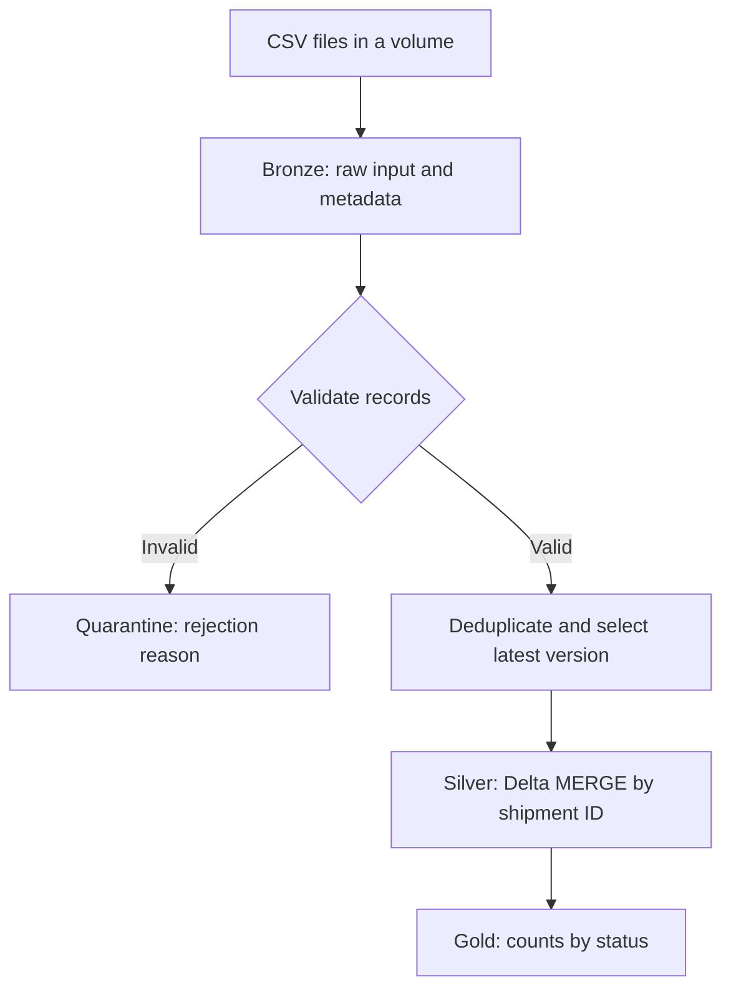

# Databricks Shipment Tracking Pipeline

A hands-on data engineering learning project that converts incoming shipment CSV files into a current-state shipment table and a delivery-status summary.

**Status:** Implementation and sample data prepared; execution in Databricks is pending. Output tables below are expected results, not screenshots or claims of a completed cloud run. See [progress and evidence](docs/PROGRESS.md).

## Business problem
A delivery company sends repeated and changing shipment records. Reports must count each shipment once and keep its newest valid status even when an older file arrives late.

The morning file says S101 is SHIPPED at version 1. The afternoon file says it is DELIVERED at version 2. The pipeline updates S101 rather than inserting a second shipment.

## Architecture

| Component | Responsibility |
|---|---|
| Unity Catalog volume | Stores sample CSV files |
| PySpark | Reads, normalizes, validates, and ranks records |
| Bronze Delta table | Retains original values and ingestion metadata |
| Quarantine Delta table | Retains invalid records with their first failed rule |
| Silver Delta table | Stores one latest valid record per shipment |
| SQL MERGE | Inserts new IDs and applies strictly newer versions |
| Gold Delta table | Provides a delivery-status summary |

## Repository contents
- `notebooks/shipment_pipeline.ipynb`: importable notebook with explanations, pipeline, and validation cells.
- `data/morning.csv` and `data/afternoon.csv`: synthetic example data, also embedded in the notebook for easy setup.
- `docs/PROGRESS.md`: execution checklist and next steps.

## Run in Databricks
1. Open your Databricks workspace. Free Edition is sufficient for this small learning exercise, subject to available quota.
2. Import `notebooks/shipment_pipeline.ipynb` into the workspace.
3. Attach the notebook to available Python/serverless compute.
4. In the configuration cell, set `CATALOG` to a catalog where you can create schemas and volumes. Leaving it blank uses the current catalog.
5. Run cells in order. Setup creates a dedicated `shipment_portfolio_demo` schema and a `landing` volume.
6. The notebook writes synthetic files to the volume, processes both batches, and builds Gold.
7. Run the assertions and replay/conflict checks; record actual results in `docs/PROGRESS.md`.

No local pip installation, AWS credentials, or production data is needed for this notebook. The notebook requires Databricks-provided `spark` and `dbutils`; it is not an ordinary standalone Python script.

**Demo reset:** The initialization cell truncates only the four named project tables in `shipment_portfolio_demo`. Keep this schema dedicated to the exercise. Set `RESET_DEMO = False` to preserve earlier runs; initial-count assertions assume a fresh reset.

## Data contract and rules
Expected CSV header: `shipment_id,city,status,version`.
- Shipment ID and city must be nonblank.
- Allowed statuses: PROCESSING, SHIPPED, DELIVERED.
- Version must be a positive integer and increases per shipment at the source.
- Each ID/version represents one consistent business value. Conflicting values within a batch fail processing.
- Exact duplicate rows are removed before MERGE.
- Incoming versions older than or equal to the Silver version do not overwrite it.

## Expected results
After the morning batch: 5 Bronze records, 1 rejected record, 3 Silver shipments.
After the afternoon batch: 7 Bronze records total, 1 rejected record total, 4 Silver shipments.

| shipment_id | city | status | version |
|---|---|---|---:|
| S101 | Dallas | DELIVERED | 2 |
| S102 | Austin | PROCESSING | 1 |
| S103 | Houston | DELIVERED | 1 |
| S104 | Plano | SHIPPED | 2 |

| status | shipment_count |
|---|---:|
| DELIVERED | 2 |
| PROCESSING | 1 |
| SHIPPED | 1 |

## Validation
The notebook contains executable assertions for initial counts, final state, duplicate-file replay, late older input, conflicting versions, and Gold totals. Python code syntax is checked during packaging. These assertions still need to run in Databricks before reporting integration success.

## Design choices and limitations
- Silver is idempotent for identical replayed data. Bronze and quarantine append each processing attempt; they are not deduplicated ingestion logs.
- This is a sequential batch demonstration, not a deployed scheduled or streaming service.
- Gold is fully refreshed after both batches; production orchestration should refresh it after successful Silver processing.
- No multi-table atomic transaction is implied: a failure can leave Bronze/quarantine committed before Silver.
- Conflicts are checked within a batch. Equal-version conflicts against an earlier batch are ignored by MERGE; production needs an explicit cross-batch conflict policy.
- Header drift, malformed CSV rows, concurrent writers, deletes, transition rules, and access-policy automation are outside this version's scope.
- All input data is synthetic. There are no customer records or credentials.

## Review and progress
The notebook is the main implementation. Follow the run guide above, then record actual validation results in [docs/PROGRESS.md](docs/PROGRESS.md). Commit new results and improvements as work progresses.

## References
- [Delta MERGE](https://docs.databricks.com/aws/en/delta/merge)
- [Files in Unity Catalog volumes](https://docs.databricks.com/aws/en/volumes/volume-files)
- [Medallion architecture](https://docs.databricks.com/aws/en/lakehouse/medallion)
